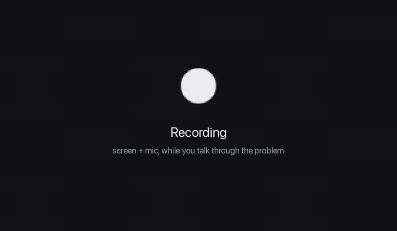
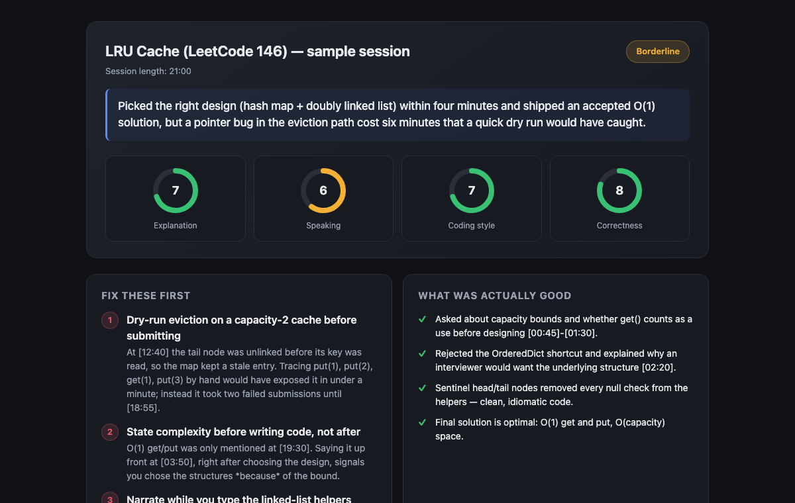

<div align="center">

# 🔍 InterviewLens

**Record yourself solving a coding problem. Get graded like a real interviewer would.**

A macOS menu-bar app that records your screen and mic while you talk through a DSA problem,
transcribes and OCRs the session **on your Mac**, and returns a timestamped, rubric-based
review — one click from "stop recording" to your report.




<sub>Demo uses a sample LRU Cache session rendered with the app's real review template.</sub>

</div>

## Why

Solving the problem is half an interview. The other half is **talking while you solve it**:
clarifying, stating complexity, not going silent for two minutes while you debug. LeetCode grades
the first half. InterviewLens grades the second.

| You get | Details |
|---|---|
| 🎯 **Four scores out of 10** | Explanation quality, speaking efficiency, coding style, correctness |
| 🛠️ **Top three fixes** | Each one cites the `[MM:SS]` moment so you can scrub to it in the recording |
| ⏱️ **Session timeline** | Silences, bugs introduced and found, key moments |
| ✍️ **Rewritten explanation** | Your weakest moment, rewritten the way a strong candidate would say it |
| 📈 **History** | Every review filed by problem name, with a browsable index to track recurring weaknesses |

<p align="center"></p>

## Quick start

```bash
git clone https://github.com/PiratedVirus/InterviewLens.git
cd InterviewLens
./setup.sh      # ffmpeg, tesseract, Python venv, native mic helper
./run.sh        # a ring icon appears in the menu bar
```

Needs the [Claude Code CLI](https://docs.claude.com/en/docs/claude-code) signed in once
(`npm install -g @anthropic-ai/claude-code && claude`). Full details in [Setup](#setup).

> **Scope:** built for my own interview prep, not a hardened product. See
> [Known limitations](#known-limitations).

---

## How it works

```
Start ─► ffmpeg records screen (10fps)  +  bin/voicerecorder records mic
Stop  ─► mic.wav ─► loudness pass ─► Whisper (local) ─► transcript.txt   [MM:SS] per line
      ─► recording.mov ─► 12 frames spread across the session ─► Tesseract (local) ─► code_ocr.txt
      ─► review_prompt.md (rubric + transcript + OCR) ─► claude --print ─► review.md
      ─► review filed under reviews/ by problem name ─► opened automatically
```

The review scores four categories out of 10 — explanation quality, speaking
efficiency, coding style, correctness — then lists the top three fixes and
rewrites your weakest explanation the way a strong candidate would say it.
Every point cites an `[MM:SS]` timestamp you can scrub to in the recording.

### What runs where

| Step | Runs on |
|---|---|
| Screen + mic recording | Your Mac |
| Speech-to-text (Whisper) | Your Mac (model downloads once, then offline) |
| Code OCR (Tesseract) | Your Mac |
| Review | **Anthropic, via the Claude Code CLI** — the transcript, OCR text and screenshots are sent as part of the review |

No API keys and no extra cost: the review runs on your existing Claude
Pro/Max/Team subscription through Claude Code. The recording video itself
stays on disk.

---

## Engineering notes

**Clean mic audio via a native helper.** ffmpeg's `avfoundation` input grabs the
raw mic stream with no noise suppression or gain control. Measured on a MacBook
Air: a −33 dB noise floor with peaks clipping at +3 dBFS, which made Whisper
produce repetition-loop garbage. `native/voicerecorder.m` is a small Objective-C
helper that records through Apple's Voice Processing I/O audio unit — the path
QuickTime and FaceTime use. Result: **−60 dB noise floor, peaks at −6.6 dB, no
clipping.** Things that cost real debugging time:

- VPIO is duplex — enabling only the input bus fails with `-10875` and delivers
  zero buffers; the output bus must be enabled and fed silence.
- `AVAudioEngine.setVoiceProcessingEnabled:` fails *silently* in a CLI process,
  so the helper uses the AudioUnit API directly.
- The built-in mic defaults to 96 kHz while output runs at 48 kHz; the helper
  pins the input to 48 kHz.

**Frames that actually cover the whole session.** A fixed `fps=1/20` with a
12-frame cap stopped at 3:40 — a 22-minute session was reviewed on its first
four minutes, and the last frame Claude saw was an empty function stub. Frame
spacing is now derived from the recording's duration, with `round=up` so the
final frame (the finished code) isn't dropped.

**Timestamped inputs.** The transcript is written as `[MM:SS]` lines rather than
one blob, so the rubric's pacing and dead-air criteria are measured from real
gaps instead of guessed.

**Resumable pipeline.** Every step is skipped when its output already exists,
so a review that times out after Whisper's slow pass can be retried without
re-transcribing (**Reprocess Unfinished Session** in the menu).

**Devices resolved by name.** avfoundation indices shift when hardware
connects — plugging in an iPhone (Continuity Camera) pushes "Capture screen 0"
from index 1 to 3 — so devices are looked up by name at record time.

---

## Setup

```bash
./setup.sh
```

Installs `ffmpeg` and `tesseract` via Homebrew, creates a Python virtualenv,
installs the Python dependencies, and compiles `bin/voicerecorder`.

**Claude Code CLI** (one time):

```bash
npm install -g @anthropic-ai/claude-code
claude            # sign in once
claude --print "say hello"
```

If `claude` isn't on your `PATH`, set `CLAUDE_CLI_PATH` in `config.py`.

**macOS permissions:** the first recording prompts for **Screen Recording** and
**Microphone** access (System Settings → Privacy & Security). You may need to
restart the app once after granting them.

To list the capture devices the app will pick:

```bash
python devices.py
```

## Running

```bash
./run.sh
```

A ring icon appears in the menu bar. It pulses while recording and becomes a
pie-chart progress indicator while processing; the menu's top line names the
current phase, e.g. "Transcribing speech… (3/6)".

## Configuration

All knobs live in `config.py`:

| Setting | Default | Notes |
|---|---|---|
| `SCREEN_DEVICE_NAME` / `AUDIO_DEVICE_NAME` | `"Capture screen"` / your mic | Matched by name; `*_INDEX` forces an index |
| `USE_NATIVE_VOICE_CAPTURE` | `True` | `False` falls back to raw ffmpeg mic capture |
| `WHISPER_MODEL` | `"small"` | `tiny`/`base` are faster, less accurate on technical terms |
| `MAX_FRAMES_TO_OCR` | `12` | Resolution of the code timeline |
| `FRAME_INTERVAL_SECONDS` | `20` | Minimum spacing (binds only on short sessions) |
| `CLAUDE_CLI_SKIP_PERMISSIONS` | `True` | Unattended writes of `review.md`; `False` prompts per new session folder |
| `CLAUDE_CLI_TIMEOUT_SECONDS` | `480` | Raise for long sessions |

Optional: to capture system audio too, install
[BlackHole](https://github.com/ExistentialAudio/BlackHole)
(`brew install blackhole-2ch`) and point the audio device at it.

## Reviewing past sessions

Each session lives in `~/DSAInterviewPrep/sessions/<timestamp>/` with the
recording, transcript, OCR text, frames and `review.md`. A flat copy of each
review is filed by problem name:

```
~/DSAInterviewPrep/reviews/
├── review-two-sum-2026-08-22_15-20-25.md
├── review-two-sum-2026-08-25_09-10-31.md   <- later attempt, never overwritten
└── review-lru-cache-2026-08-23_11-05-02.md
```

Claude infers the problem name and writes it as an invisible
`<!-- question-slug: ... -->` marker on the review's first line. Tracking a
recurring weakness is then just:

```bash
ls ~/DSAInterviewPrep/reviews/review-two-sum-*
grep -l "complexity" ~/DSAInterviewPrep/reviews/*
```

**Open Reviews Folder** and **Show Last Review** in the menu jump straight there.

## Known limitations

- **OCR on code is imperfect.** Tesseract misreads some brackets, indentation
  and look-alike characters (`l`/`1`/`I`, `O`/`0`). The prompt tells Claude to
  infer intent; for exact code, save a `.py`/`.txt` into the session folder
  before stopping.
- **Processing takes real time.** Whisper takes seconds to a couple of minutes
  depending on session length and model size, and the Claude review a few
  minutes more.
- **Claude Code CLI versions differ** in whether `--print` writes files. The
  pipeline writes `review.md` from stdout if the CLI didn't. To debug:
  ```bash
  cd ~/DSAInterviewPrep/sessions/<timestamp>
  claude --print "$(cat review_prompt.md)"
  ```
- Runs as a script (`./run.sh`), not a bundled `.app`.

## Stack

Python (`rumps`), Objective-C (AudioToolbox / AVFoundation), ffmpeg,
OpenAI Whisper, Tesseract, Claude Code CLI.

## License

[MIT](LICENSE) © 2026 Saurabh Kulkarni
